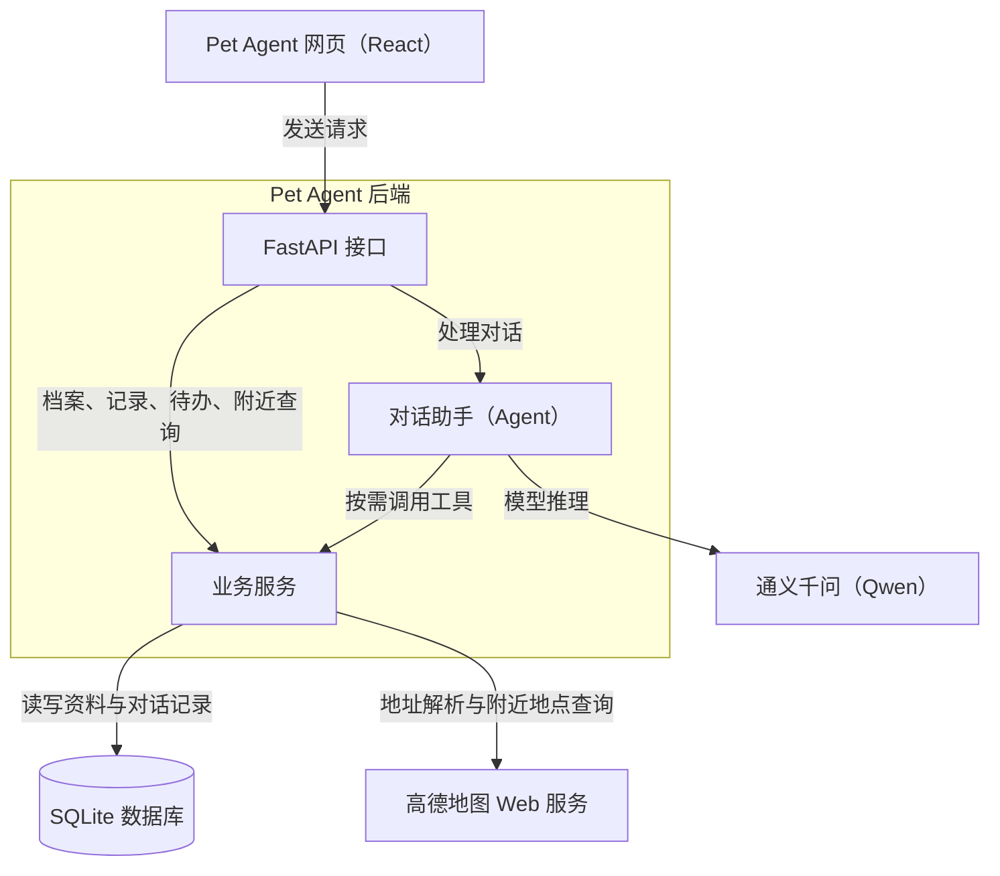

# Pet Agent

Pet Agent 是一个宠物生活助手。你可以为多只宠物建立档案、记录日常护理、安排待办、向助手提问，并查找附近的宠物服务。

**在线使用** · 项目已部署在 ECS，打开浏览器即可使用。[访问 Pet Agent](https://petagent.icu/)

## 主要功能

- **宠物档案**。为多只宠物分别建立档案，随时切换当前宠物。
- **日常记录**。记录疫苗、驱虫、洗澡和体重，查看称重趋势。
- **待办提醒**。安排护理事项，按需关联一条记录，处理后标记完成。
- **宠物助手**。咨询日常养护问题，也可以关联当前宠物，让助手结合档案回答。遇到急症，请及时联系兽医。
- **附近服务**。通过定位或手动输入地址，查找附近的宠物医院、美容店和用品店。
- **寻宠信息卡**。整理走失宠物的信息，预览并复制文字卡，方便自行分享。

## 技术栈

| 部分 | 技术 |
| --- | --- |
| 前端 | React、TypeScript、Vite |
| 后端 | Python、FastAPI、Pydantic |
| 数据库与迁移 | SQLite、SQLAlchemy、Alembic |
| 对话助手 | Python Agent、通义千问（Qwen） |
| 附近服务 | 高德开放平台 Web 服务 |

## 系统架构



## 启动

### 在线使用

直接访问已部署的站点。[petagent.icu](https://petagent.icu/)

### 本地运行

需要 Python 3.10+ 和 Node.js 20.19+ 或 22.12+。在仓库根目录启动后端：

```bash
python -m pip install -e "./backend[dev]"
python -m uvicorn app.main:app --app-dir backend --reload
```

另开一个终端，从仓库根目录启动前端：

```bash
cd frontend
npm ci
npm run dev
```

打开 Vite 输出的本地地址。开发时，前端默认把 API 请求转发到 `http://127.0.0.1:8000`。

本地前端的档案、对话、记录和待办默认使用演示模式。要接入本地后端，在 `frontend/.env.local` 中添加以下设置，然后重启前端：

```dotenv
VITE_PET_DATA_SOURCE=api
VITE_CHAT_DATA_SOURCE=api
VITE_RECORD_DATA_SOURCE=api
VITE_REMINDER_DATA_SOURCE=api
```

本地使用 Qwen 或查询真实附近地点时，分别在仓库根目录的 `.env` 中配置 `LLM_API_KEY` 和 `AMAP_WEB_SERVICE_KEY`。其他可选配置见 [.env.example](.env.example)。

开发资料可查阅[技术栈说明](docs/TECH_STACK.md)、[接口文档](docs/API.md)和[项目任务记录](docs/TASKS.md)。


### 附近服务的高德底图

在 `frontend/.env.local` 配置下列变量并重启 Vite。使用高德开放平台「Web 端（JS API）」应用的 Key 和配套安全密钥。

```dotenv
VITE_AMAP_JS_KEY=
AMAP_JS_SECURITY_CODE=
```

前端使用高德 JS API 2.0 和官方加载器 `@amap/amap-jsapi-loader@1.0.1`（MIT）。开发服务器通过同源 `/_AMapService/` 为底图初始化请求注入安全密钥。构建产物部署时，需在托管服务的反向代理配置相同路径并由服务端注入 `jscode`，Vite 的开发代理不会随构建产物发布。附近地点仍由后端 Web 服务 Key 查询，两套凭据分别配置。[JS API 快速上手](https://lbs.amap.com/api/javascript-api-v2/getting-started) · [安全密钥代理](https://lbs.amap.com/api/maps-javascript-api/guide/abc/jscode)

打开「附近服务」并选择演示区域，核对道路底图、查询中心和编号标记。点击列表项可将地图移至对应标记，点击标记可选中对应列表项。拖动地图只改变视图。拒绝定位后可选择演示区域或输入地址。底图加载失败时可继续使用地点列表。配置后端 Web 服务 Key 后，再使用定位或地址验证地点来源标为高德实时，并抽查地标位置。
