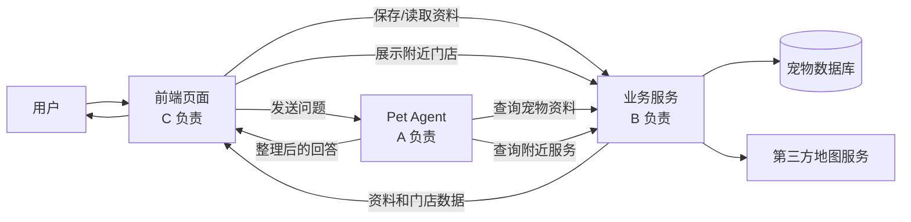
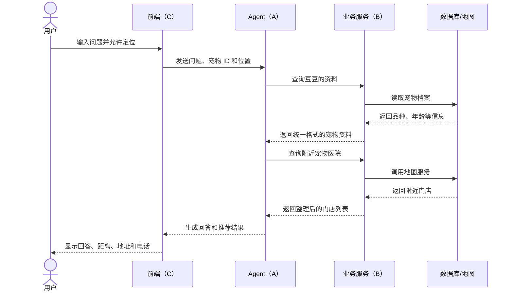
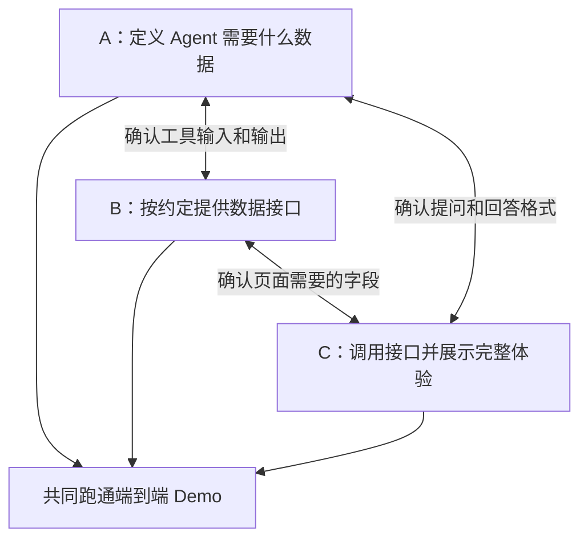

# Pet Agent 架构与任务说明（易读版）

## 1. 这个项目要做什么？

Pet Agent 是一个宠物助手。用户可以：

- 保存宠物的名称、品种、年龄和健康备注；
- 用自然语言询问喂养、护理等问题；
- 在 P1 阶段查看附近的宠物医院、宠物洗护店和宠物用品店；
- 在同一个页面里完成提问、查看建议和寻找线下服务。

简单理解：P0 先把 **聊天助手和宠物档案** 接起来；地图服务是 P1 扩展。A、B、C 使用同一套优先级，地图功能不会单独成为 B 的 P0。

## 2. 整体架构

下图展示包含 P1 地图功能的完整形态；只做 P0 时，先忽略“附近门店”和“第三方地图服务”相关连线。

### 用一句话理解每一层

| 部分 | 像什么 | 主要作用 |
|---|---|---|
| 前端（C） | 门店的接待台 | 接收用户操作，把结果清楚地展示出来 |
| Agent（A） | 懂宠物知识的接待员 | 理解用户想做什么，决定是否需要查询资料或地图 |
| 业务服务（B） | 后台工作人员 | 按统一规则处理宠物资料和门店查询 |
| 数据库 | 档案柜 | 保存宠物资料 |
| 地图服务 | 外部地图资料库 | 提供附近医院、洗护店和用品店的信息 |

## 3. 一次完整请求是怎样完成的？

先看 P0 主流程：用户保存“豆豆”的资料，询问“豆豆 3 岁了，平时怎么护理？”，前端把问题和宠物 ID 发给 Agent；Agent 向 B 查询豆豆的档案，再组织回答。下面是加入 P1 地图功能后的扩展流程，以“我家豆豆附近有哪些宠物医院？”为例：

关键点是：

- C 不需要理解模型内部逻辑，只负责把问题和必要信息交给 A；
- A 通过 B 提供的统一接口查询宠物资料；P1 地图查询也沿用这一方式；
- B 不负责组织自然语言回答，只负责返回可靠、结构统一的数据；
- 任意一层失败，都应该返回可理解的提示，不能让页面直接卡住。

## 4. 三个人分别负责什么？

### A：让 Agent “听得懂、会判断、能回答”

A 负责整个系统的智能部分。

**P0：演示必须完成**

- 写好 Agent 的角色说明和回答规则；
- 判断用户是在普通提问，还是需要查询宠物资料；
- 根据需要调用 B 的宠物资料接口；
- 信息不够时先追问，不随意编造；
- 医疗问题给出风险提示，提醒必要时咨询兽医；
- 接口失败时给出友好说明。

**P1：有时间再完善**

- 识别寻找附近门店的意图，调用 B 的地图接口；
- 记住同一次对话中的宠物信息；
- 说明推荐门店的理由；
- 优化回答语气和内容长度。

**A 的交付结果：**P0 能结合宠物资料合理回答；P1 再使用地图能力。

### B：让数据“存得住、查得到、格式统一”

B 负责数据库和业务接口；P1 再负责地图服务。

**P0：演示必须完成**

- 设计最小可用的用户和宠物资料结构；
- 提供保存、读取宠物资料的接口；
- 给 A、C 提供宠物资料接口示例。

**P1：有时间再完善**

- 根据位置查询附近的医院、洗护店和用品店；
- 统一门店数据格式，如名称、类别、距离、地址和电话；
- 准备固定的地图演示数据，在地图服务异常时也能展示扩展流程；
- 按门店类别筛选、按距离排序；
- 增加缓存，减少重复查询；
- 完善超时、限流等保护。

**B 的交付结果：**P0 让 A 和 C 用固定方式获得宠物资料；P1 再提供门店信息。

### C：让系统“看得见、用得顺、演得稳”

C 负责前端页面、用户体验和最终演示。

**P0：演示必须完成**

- 完成聊天页面；
- 完成宠物资料的填写、保存和读取；
- 接通 A、B 的真实接口；
- 显示加载中和核心接口失败等状态；
- 准备固定演示账号和宠物资料。

**P1：有时间再完善**

- 用地图或列表展示附近门店，处理无定位权限和无结果状态；
- 准备固定演示位置；
- 增加快捷问题和门店分类筛选；
- 优化地图标记、页面样式和手机适配；
- 增加一键重置演示数据。

**C 的交付结果：**P0 让用户顺畅完成保存资料和提问；P1 再增加查找门店。

## 5. 三人如何配合？

三人先约定三个 P0 接口；开始地图扩展时再确定第四个接口：

| 接口 | 用途 | 谁提供 | 谁使用 |
|---|---|---|---|
| 读取宠物资料 | 获取名称、品种、年龄、健康备注 | B | A、C |
| 保存宠物资料 | 新建或修改宠物档案 | B | C |
| 查询附近门店（P1） | 按位置和类别返回门店列表 | B | A、C |
| Agent 对话 | 理解问题并生成最终回答 | A | C |

接口内部可以分别开发，但字段名称确定后不要随意修改。确实需要改动时，应同时通知另外两人并更新示例。

## 6. 三天怎么推进？

| 时间 | 主要工作 | 当天结束时应看到的结果 |
|---|---|---|
| 第 1 天：搭骨架 | A 定回答规则和工具格式；B 定数据和接口；C 搭页面框架 | 三部分都能用假数据单独运行，接口字段正式确定 |
| 第 2 天：接起来 | A、C 接入 B 的宠物资料接口，三人共同处理联调问题 | “填写宠物资料 → 提问 → 获得个性化回答”可以完整跑通 |
| 第 3 天：保稳定 | 先补完 P0、准备演示和彩排；有余力再做地图 | 核心流程无需改代码即可连续演示，三人共同完整彩排至少两次 |

## 7. P1 地图演示为什么要准备兜底数据？

地图服务可能因为网络、额度或服务状态临时失败。如果决定展示 P1，可准备一组固定数据：

- 固定宠物：例如“豆豆，金毛，3 岁”；
- 固定位置：例如学校、公司或会场附近；
- 固定门店：每一类别准备 2～3 条；
- 明确提示当前使用的是演示数据。

演示时应明确标注数据来源，避免把固定数据说成实时搜索结果。

## 8. 共同验收标准

下列 P0 流程能一次连续完成，就说明三部分已经真正接通：

- [ ] 打开系统并读取演示宠物资料；
- [ ] 修改一项资料，保存后重新打开仍能看到；
- [ ] 提出与该宠物有关的问题，回答会使用宠物资料；
- [ ] 信息不足时，Agent 会追问而不是编造；
- [ ] 医疗类回答包含必要的风险提醒；
- [ ] 模型或资料接口失败时有清楚提示；
- [ ] 整个过程无需手工修改代码或数据库；
- [ ] README 中写明启动方式、环境变量和演示步骤；
- [ ] 三人共同完整彩排至少两次。

P1 完成后再验收：能查询附近三类门店并显示名称、类别、距离和地址；电话缺失、拒绝定位或地图接口失败时页面不报错。

## 9. 演示时可以这样介绍

> 这个系统分为三部分：前端负责接收和展示，Agent 负责理解用户意图，业务服务负责保存和提供宠物资料。P0 先完成“保存资料、提问、结合资料回答”的闭环；P1 再接入附近门店地图查询。三部分通过固定接口连接，可以并行开发。

更具体的执行表、接口约定和 Git 规则，请配合《Pet Agent：三人任务拆分（3 天版）》使用。
